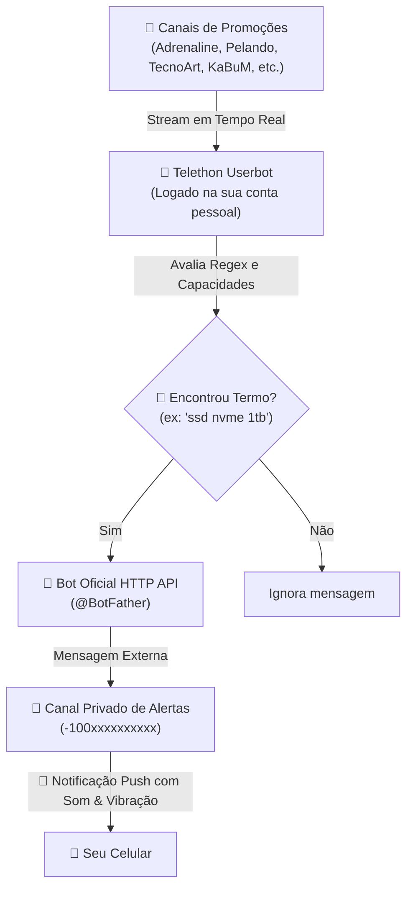

# 🤖 Bot of Bots - Telegram Deal & Hardware Monitor

<p align="center">
  
  
  
  
</p>

Sistema automatizado de monitoramento de ofertas e palavras-chave em tempo real no Telegram, projetado para rodar em servidores locais (Homelab / VPS) com **arquitetura híbrida** de alta confiabilidade e **notificações push sonoras garantidas** no celular.

---

## 🎯 Por que a Arquitetura Híbrida?

A maioria dos bots de Telegram sofre de uma das duas limitações:
1. **Bots comuns de API (@BotFather):** Não conseguem ler mensagens de grupos e canais públicos a menos que sejam adicionados como administradores neles.
2. **Userbots tradicionais (MTProto/Telethon):** Conseguem ler todos os canais que você participa, mas quando enviam o alerta para você mesmo ou para um canal seu, **o Telegram silencia a notificação** (pois você é o autor da mensagem).

### A Solução do Bot of Bots:


1. **Escuta:** Sua conta pessoal (Userbot) lê silenciosamente todos os grupos e canais de ofertas que você participa.
2. **Filtro Inteligente:** Quando surge uma mensagem com todas as palavras-chave (ex: `SSD Kingston NVMe M.2 1TB`), o alerta é disparado.
3. **Notificação Real:** O envio é feito através de um **Bot oficial do BotFather** diretamente no seu canal privado de alertas. Como a mensagem vem de um remetente externo, **seu celular toca, vibra e emite o pop-up na tela na mesma hora**.

---

## 🚀 Funcionalidades

- ⚡ **Detecção em Tempo Real:** Captura ofertas no milissegundo em que são postadas.
- 🧠 **Motor de Busca Multi-Palavras:**
  - Encontra termos mesmo que as palavras estejam fora de ordem (ex: `ssd nvme 1tb` encontra `"SSD Kingston 1 TB NVMe"`).
  - Normaliza unidades de armazenamento (`1tb` casa com `1tb` e `1 tb`, `2tb`, `500gb`, etc.).
- 🔄 **Hot-Reload de Palavras:** Adicione ou remova termos no arquivo `keywords.txt` em tempo real **sem precisar reiniciar o container**.
- 🔗 **Links Diretos:** Gera o link direto para a mensagem original no canal de origem para você comprar rápido antes que acabe o estoque.
- 🛡️ **Zero Dependência Externa no Alerta:** O envio do alerta utiliza a biblioteca padrão HTTP do Python (`urllib.request`), evitando quebras de dependência.
- 🐳 **Pronto para Docker:** Container leve com Python 3.11 Slim e reinício automático (`restart: unless-stopped`).

---

## 📁 Estrutura do Repositório

```text
BotofBots/
├── .ai-memory.toml         # Configuração de sessões de memória do ai-memory
├── .env.example            # Modelo de variáveis de ambiente
├── .gitignore              # Proteção para nunca subir credenciais ou sessões
├── Dockerfile              # Imagem leve otimizada
├── docker-compose.yml      # Orquestrador do container
├── requirements.txt        # Dependências Python (Telethon)
├── keywords.example.txt    # Modelo de lista de termos monitorados
├── bot.py                  # Aplicação principal do bot
├── TODO.md                 # Roadmap e backlog de melhorias futuras
└── scripts/
    ├── gerar_sessao.py     # Gerador interativo da StringSession Telethon
    └── listar_chats.py     # Utilitário para listar IDs de canais/grupos
```

---

## 📋 Roadmap & Próximas Melhorias

Consulte o arquivo [TODO.md](TODO.md) para ver as ideias em andamento, incluindo:
- 📱 **Gestão de termos via chat no Telegram** (`/add`, `/del`, `/list`) direto do celular.
- 🌐 **Mini Dashboard Web no Homelab** (interface visual para gerenciar palavras e ver histórico).
- 🏷️ **Filtro de preço teto** (ex: `ssd nvme 1tb <= 380`).
- 🛡️ **Deduplicação de ofertas e anti-spam**.

---

## 🛠️ Passo a Passo de Configuração

### 1. Pré-Requisitos
- Ter o **Python 3.10+** ou **Docker / Docker Compose** instalado.
- Conta ativa no Telegram.

---

### 2. Obter as Credenciais Oficiais do Telegram (API_ID e API_HASH)
1. Acesse o portal oficial de desenvolvedores do Telegram: [https://my.telegram.org](https://my.telegram.org).
2. Faça login com seu número de telefone e o código recebido no aplicativo.
3. Clique em **API development tools**.
4. Crie uma aplicação (o nome e short name podem ser qualquer coisa, ex: `DealMonitor`).
5. Copie o **`App api_id`** (número) e o **`App api_hash`** (texto hexadecimal).

---

### 3. Gerar a StringSession Persistente
Para que o bot no Docker não fique pedindo código SMS toda vez que reiniciar, geramos uma string de autenticação definitiva:

1. Clone o projeto e instale as dependências:
   ```bash
   git clone https://github.com/pexinn/BotofBots.git
   cd BotofBots
   pip install -r requirements.txt
   ```
2. Execute o script gerador:
   ```bash
   python scripts/gerar_sessao.py
   ```
3. Informe seu `API_ID`, `API_HASH`, telefone com DDD e o código recebido no Telegram.
4. O script exibirá sua **`TELEGRAM_STRING_SESSION`**. Copie esse texto.

---

### 4. Criar o Bot de Notificação no @BotFather
1. No Telegram, converse com o bot oficial **[@BotFather](https://t.me/BotFather)**.
2. Envie o comando `/newbot`.
3. Escolha um nome (ex: `Alertas de Promoções`) e um username que termine em `bot` (ex: `meu_alerta_pessoal_bot`).
4. O BotFather fornecerá o **Token HTTP API** (ex: `1234567890:ABCdef...`). Guarde este token.

---

### 5. Criar o Canal Privado de Alertas
1. No seu aplicativo do Telegram, crie um **Novo Canal**.
2. Defina o tipo como **Canal Privado**.
3. Acesse as configurações do canal recém-criado:
   - Vá em **Administradores** -> **Adicionar Administrador**.
   - Busque pelo username do seu bot criado no passo anterior (ex: `@meu_alerta_pessoal_bot`).
   - Conceda permissão de **Postar Mensagens** e salve.

---

### 6. Descobrir o ID do seu Canal de Alertas
1. Execute o script utilitário:
   ```bash
   python scripts/listar_chats.py
   ```
2. Ele listará todas as suas conversas recentes. Encontre o canal de alertas e copie o **ID com o sinal negativo** (ex: `-1003831224619`).

---

### 7. Configurar o arquivo `.env`
Copie o arquivo de exemplo:
```bash
cp .env.example .env
```

Edite o `.env` com suas informações:
```env
API_ID=31877296
API_HASH=38f1dbcee70a13157deba49b7bb42ba6
TELEGRAM_STRING_SESSION=1AZWarzwBu49RzPs...
ALERT_DESTINATION=-1003831224619
TELEGRAM_BOT_TOKEN=9016522051:AAG8KtG2CA3Zl1mTinVNCfDkq9xnbB5Rol8
```

---

### 8. Configurar as Palavras-Chave
Crie seu arquivo de termos:
```bash
cp keywords.example.txt keywords.txt
```

Edite o `keywords.txt` adicionando um produto por linha:
```text
ssd nvme 1tb
rtx 4060
ryzen 7 5700x3d
monitor 144hz
```

---

## 🐳 Executando com Docker Compose

Suba o bot em segundo plano com um único comando:

```bash
docker compose up -d --build
```

Para acompanhar os logs em tempo real:
```bash
docker compose logs -f
```

Você verá a mensagem de inicialização confirmando a conexão e enviando o aviso de boas-vindas diretamente para o seu canal!

---

## ⚡ Como Adicionar / Remover Palavras em Produção

Você **NÃO precisa reiniciar o container** para mudar as palavras monitoradas.

1. No servidor, abra o arquivo:
   ```bash
   nano keywords.txt
   ```
2. Adicione, edite ou apague as linhas que desejar.
3. Salve (`Ctrl+O`, `Enter`) e feche (`Ctrl+X`).
4. O bot detecta a alteração automaticamente e exibe nos logs:
   ```text
   [19:41:12] Palavras-chave recarregadas (3): ['ssd nvme 1tb', 'rtx 4060', 'ryzen 7 5700x3d']
   ```

---

## 🔒 Segurança

- **NUNCA compartilhe sua `TELEGRAM_STRING_SESSION`:** Ela dá acesso total à sua conta do Telegram, exatamente como o login do aplicativo.
- O arquivo `.gitignore` já vem configurado para **bloquear** o envio acidental de `.env`, `keywords.txt` e arquivos de sessão `.session`.
- Mantenha sempre seus segredos protegidos.

---

## 📄 Licença

Distribuído sob a licença MIT. Sinta-se livre para customizar e adaptar para seus próprios canais e filtros de ofertas!

