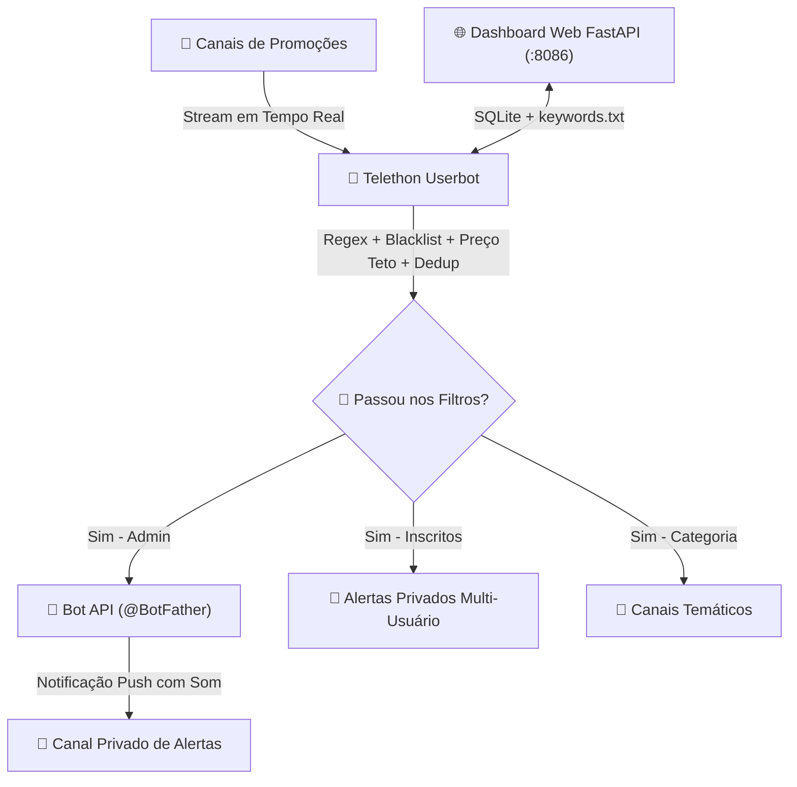

# 🤖 Bot of Bots - Telegram Deal & Hardware Monitor

<p align="center">
  
  
  
  
  
</p>

Sistema automatizado de monitoramento de ofertas e palavras-chave em tempo real no Telegram, projetado para rodar em servidores locais (Homelab / VPS) com **arquitetura híbrida**, **notificações push sonoras**, **filtros inteligentes**, **gestão via chat e Dashboard Web** e **suporte multi-usuário**.

---

## 🎯 Por que a Arquitetura Híbrida?



1. **Escuta (Telethon Userbot):** Lê silenciosamente todos os grupos e canais de ofertas em que você participa.
2. **Motor Inteligente:** Avalia palavras-chave fora de ordem, normaliza unidades (`1tb` = `1 tb`), bloqueia marcas/termos negativos (`-kootion`), extrai preços em Reais (`R$`) ignorando parcelas e evita spam com deduplicação por URL canônica.
3. **Notificação Real + Comandos:** O Bot do BotFather dispara notificações sonoras e responde a comandos de gestão tanto do administrador quanto de amigos inscritos.

---

## 🚀 Funcionalidades

- ⚡ **Detecção em Tempo Real** com normalização de unidades (`1tb`, `500gb`, `144hz`, `750w`).
- 🚫 **Exclusão de Marcas / Blacklist (`-` ou `!`):**
  - Por regra: `ssd nvme 1tb -kootion -sata -usado` (monitora SSD NVMe 1TB, mas descarta se for Kootion, SATA ou usado).
  - Global: `-leilao` em linha isolada bloqueia a palavra em todas as buscas.
- 💰 **Filtro de Preço Máximo (Teto):**
  - Ex: `ssd nvme 1tb -kootion <= 380` ou `rtx 4060 < 1800`.
  - Ignora automaticamente valores de parcelamento (`10x de R$ 42,90`), cupons e frete.
- 🛡️ **Deduplicação e Anti-Spam:** Normaliza links (Amazon ASIN, Mercado Livre MLB, remove `utm_*`) e evita alertas repetidos na janela configurada (`DEDUP_WINDOW_MINUTES=30`).
- 📱 **Gestão via Telegram:**
  - **Admin (`ADMIN_USER_ID`):** `/add`, `/del`, `/list`, `/block`, `/unblock`, `/blacklist`, `/pause`, `/resume`, `/status`, `/usuarios`, `/limite`, `/canais`.
  - **Multi-Usuário (Amigos/Público):** `/start`, `/alerta`, `/meusalertas`, `/remover`, `/help`.
- 🌐 **Dashboard Web Moderno (`:8086`):**
  - Gestão visual de tags/chips de palavras e blacklist global.
  - Botão de Pausar/Retomar monitoramento.
  - Histórico completo de ofertas com filtros por termo, categoria e preço.
  - Gráfico de variação de preço ao longo do tempo e ranking dos canais mais rápidos (`deals.db`).
  - Gestão de inscritos multi-usuário e canais temáticos (`Hardware & PC`, `Periféricos`, `Games & Consoles`).
- 🔄 **Hot-Reload Bidirecional:** Edições em `keywords.txt` sincronizam com o SQLite e edições via Telegram/Web atualizam `keywords.txt`.
- 🐳 **Self-Hosted 1-Click:** `setup.sh`, `setup.bat`, `docker-compose.ghcr.yml`, `portainer-template.json` e workflow CI/CD para GHCR.

---

## 📁 Estrutura do Repositório

```text
BotofBots/
├── .github/workflows/docker-publish.yml  # CI/CD: pytest + build & push GHCR
├── app/
│   ├── categories.py                     # Categorias e canais temáticos
│   ├── commands.py                       # Roteador de comandos Admin e Multi-Usuário
│   ├── config.py                         # Carregador tipado de variáveis (.env)
│   ├── database.py                       # Persistência SQLite (WAL) e analytics
│   ├── engine.py                         # Motor de avaliação, dedup e disparo
│   ├── keywords_sync.py                  # Sincronização keywords.txt <-> SQLite
│   ├── rules.py                          # Parser de regras, blacklist, preço e URLs
│   ├── telegram_api.py                   # Cliente assíncrono Bot API (httpx)
│   └── web/
│       ├── server.py                     # API REST + FastAPI + auth opcional
│       └── templates/index.html          # Interface Web (Tailwind + Alpine + Chart.js)
├── scripts/
│   ├── gerar_sessao.py                   # Gerador interativo de StringSession
│   └── listar_chats.py                   # Listador de IDs de chats/canais
├── tests/                                # Suíte completa de testes pytest
├── bot.py                                # Entrypoint unificado (Telethon + Bot API + Web)
├── docker-compose.yml                    # Build local
├── docker-compose.ghcr.yml               # Imagem pré-compilada GHCR
├── portainer-template.json               # Template 1-Click para Portainer
├── setup.sh / setup.bat                  # Assistentes interativos de configuração
└── TODO.md                               # Roadmap do projeto
```

---

## 🛠️ Configuração Rápida (1-Click Setup)

### Linux / Homelab
```bash
git clone https://github.com/pexinn/BotofBots.git
cd BotofBots
chmod +x setup.sh
./setup.sh
```

### Windows
```powershell
git clone https://github.com/pexinn/BotofBots.git
cd BotofBots
.\setup.bat
```

### Manual com Docker Compose
1. Copie `.env.example` para `.env` e preencha suas credenciais (`API_ID`, `API_HASH`, `TELEGRAM_STRING_SESSION`, `TELEGRAM_BOT_TOKEN`, `ALERT_DESTINATION`, `ADMIN_USER_ID`).
2. Copie `keywords.example.txt` para `keywords.txt`.
3. Suba o container:
   ```bash
   docker compose up -d --build
   ```
4. Acesse o Dashboard Web em `http://SEU-IP:8086`.

---

## 🧪 Testes Automatizados

```bash
python -m venv .venv
# Windows: .venv\Scripts\pip.exe install -r requirements-dev.txt
# Linux:   .venv/bin/pip install -r requirements-dev.txt
pytest -v
```

---

## 📄 Licença

Distribuído sob a licença MIT.
