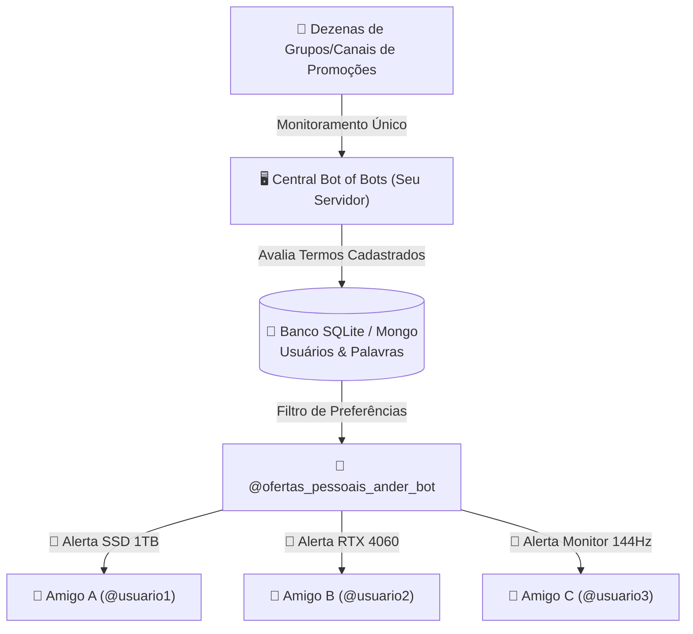

# 📋 Roadmap & Backlog de Melhorias - Bot of Bots

Este documento reúne ideias, melhorias e evolução arquitetural para o **Bot of Bots**, com foco especial em tornar a **manutenção e gestão de palavras-chave o mais simples e rápida possível**, direto do celular ou de uma interface visual.

---

## 🎯 Prioridade Alta: Facilidade de Gestão de Palavras

### 1. Gestão Direta via Comandos no Telegram (A Mais Prática)
> **Objetivo:** Adicionar ou remover produtos monitorados sem precisar abrir terminal, SSH ou computador — direto pelo chat com o bot no Telegram.

- [ ] **Comando `/list`:**
  - Exibe a lista numerada de todas as palavras e termos atualmente monitorados.
- [ ] **Comando `/add <termo>`:**
  - Adiciona uma nova palavra-chave diretamente ao arquivo `keywords.txt`.
  - Exemplo: `/add rtx 4060 ti` ou `/add ryzen 7 5700x3d`.
  - Responde com confirmação imediata.
- [ ] **Comando `/del <número ou termo>`:**
  - Remove o termo da lista com base no índice ou nome.
- [ ] **Comando `/status`:**
  - Exibe métricas de funcionamento: uptime do container, total de mensagens processadas hoje, grupos monitorados e total de alertas disparados.
- [ ] **Segurança por `ADMIN_USER_ID`:**
  - O bot só aceita comandos de configuração se o `user_id` da mensagem for o seu ID do Telegram (`904378967`), ignorando qualquer outro usuário.

---

### 2. Mini Dashboard Web no Homelab (Web UI)
> **Objetivo:** Uma interface visual limpa, responsiva e moderna rodando em uma porta local do Homelab (ex: `http://192.168.68.88:8085`).

- [ ] **Stack recomendada:**
  - Backend leve em **FastAPI** ou **Flask** assíncrono.
  - Frontend moderno com **Tailwind CSS + Alpine.js** ou **Streamlit** (tudo empacotado no mesmo container ou via compose).
- [ ] **Recursos da Interface:**
  - Visualização de palavras ativas em formato de *tags/chips* coloridos.
  - Botão de adicionar nova palavra e excluir com um clique.
  - Histórico das últimas ofertas capturadas (com data, grupo de origem, preço detectado e link).
  - Toggle de "Pausar monitoramento" temporariamente.

---

## 🚀 Prioridade Média: Filtros Inteligentes e Qualidade dos Alertas

### 3. Filtro de Preço Máximo (Teto de Alerta)
> **Objetivo:** Evitar alertas de produtos com preço acima do valor de oportunidade desejado.

- [ ] **Sintaxe de Regras:**
  - Permitir definir teto na linha: `ssd nvme 1tb <= 380` ou `rtx 4060 <= 1750`.
- [ ] **Parser de Moeda:**
  - Expressão regular para extrair valores em Reais da mensagem (`R\$\s*(\d+[\.,]?\d*)`).
  - Se o preço for superior ao teto configurado, descarta o alerta.

### 4. Deduplicação e Cooldown Anti-Spam
> **Objetivo:** Quando uma promoção boa sai, 10 canais diferentes postam a mesma coisa em minutos. Evitar receber 10 apitos seguidos da mesma oferta.

- [ ] Cache em memória / SQLite das URLs das ofertas dos últimos 30 minutos.
- [ ] Se o mesmo link ou oferta similar for postada em outro canal em menos de $X$ minutos, o alerta não é reenviado.

### 5. Palavras Negativas / Blacklist
> **Objetivo:** Filtrar ruído (ex: não querer anúncios de produtos usados, cabos ou caixas).

- [ ] Suporte a termos negativos precedidos por `-` ou `!`.
- [ ] Exemplo: `ssd nvme 1tb -sata -usado -leilao`.

---

## 📊 Prioridade Baixa: Métricas e Histórico de Preços

### 6. Histórico de Preços e Estatísticas
- [ ] Registro das ofertas em banco SQLite leve (`deals.db`).
- [ ] Gráfico mostrando a variação de preço de um item ao longo das semanas.
- [ ] Ranking dos canais mais rápidos e com melhores descontos.

---

## 👥 Prioridade Alta: Como Disponibilizar para Outras Pessoas

Atualmente o bot roda para você. Existem **3 caminhos principais** para disponibilizar essa solução para amigos, família ou para o público em geral:

---

### 1. Modelo "Bot Centralizado Multi-Usuário" (Recomendado ⭐⭐⭐⭐⭐)
> **Como funciona:** O seu Homelab/VPS continua sendo a "central" que escuta todos os canais de ofertas com o Telethon. Qualquer pessoa simplesmente abre o bot no Telegram e escolhe o que quer receber no privado dela!

- **Vantagem para os outros:** Ninguém precisa de API do Telegram, nem de servidor, nem de Docker. Eles só dão `/start` no bot e pronto.
- [ ] **Banco de Dados de Inscrições (SQLite ou MongoDB):**
  - Tabela `usuarios`: `chat_id`, `username`, `data_cadastro`, `ativo`.
  - Tabela `termos_usuario`: `id`, `chat_id`, `termo`, `preco_maximo`.
- [ ] **Fluxo do Usuário no Telegram:**
  - Usuário manda `/start` para o bot.
  - Comandos disponíveis para qualquer usuário:
    - `/alerta <termo>`: Adiciona um produto que ele quer vigiar (ex: `/alerta rtx 4060`).
    - `/meusalertas`: Lista os termos que ele cadastrou com opção de apagar.
    - `/remover <termo>`: Remove um alerta dele.
- [ ] **Motor de Distribuição Segmentada:**
  - Quando uma oferta cai na central, o bot varre quais usuários têm interesse naquele termo e despacha o alerta no privado de cada um individualmente!
- [ ] **Controle de Limites:**
  - Limite de $X$ alertas por usuário para evitar abusos (ex: máximo de 5 palavras para amigos).

---

### 2. Modelo "Canais Temáticos por Categoria" (Zero Configuração para Amigos)
> **Como funciona:** Você cria canais públicos ou privados temáticos e qualquer pessoa apenas entra no canal de interesse dela.

- [ ] **Exemplo de Canais:**
  - `🚨 Alertas - Hardware & PC` (SSD, GPU, CPU, RAM, Fontes)
  - `🚨 Alertas - Periféricos` (Mouses, Teclados, Headsets, Monitores)
  - `🚨 Alertas - Games & Consoles` (PS5, Xbox, Switch, Jogos)
- [ ] O bot classifica as ofertas por categoria e posta no canal correspondente.
- [ ] Amigos só precisam clicar no link de convite do canal que quiserem acompanhar.

---

### 3. Modelo "Self-Hosted 1-Click" (Para outros Devs / Homelabbers)
> **Como funciona:** Permitir que qualquer pessoa que tenha um Homelab ou VPS rode a sua própria instância do projeto em 1 minuto.

- [ ] **GitHub Container Registry (GHCR):**
  - Configurar GitHub Actions para gerar e publicar a imagem automaticamente: `ghcr.io/pexinn/botofbots:latest`.
- [ ] **Template 1-Click para Portainer / CasaOS / Unraid:**
  - Criar um `docker-compose.yml` simplificado ou template com campos de formulário para preencher `.env`.
- [ ] **Script de Inicialização Automática (`setup.sh` / `setup.bat`):**
  - Um script que roda interativamente: pergunta `API_ID`, `API_HASH`, gera a StringSession e já sobe o Docker sem o usuário digitar código.

---

## 📌 Como Contribuir ou Priorizar
Para implementar qualquer uma dessas ideias, basta abrir uma branch a partir de `main` e submeter um Pull Request ou aplicar diretamente no Homelab!

